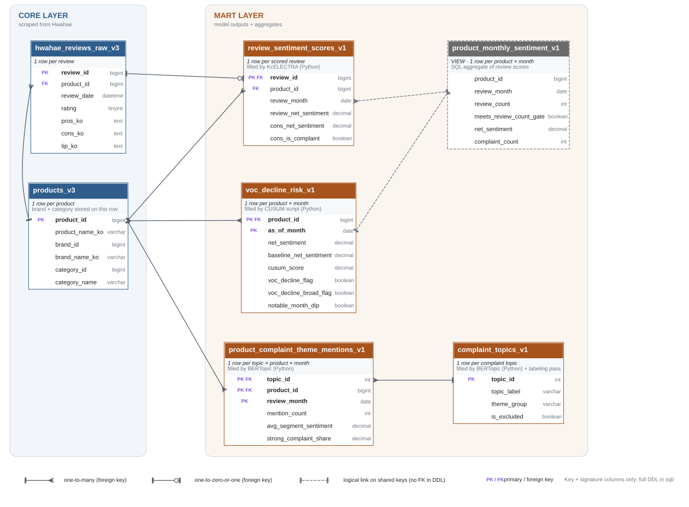
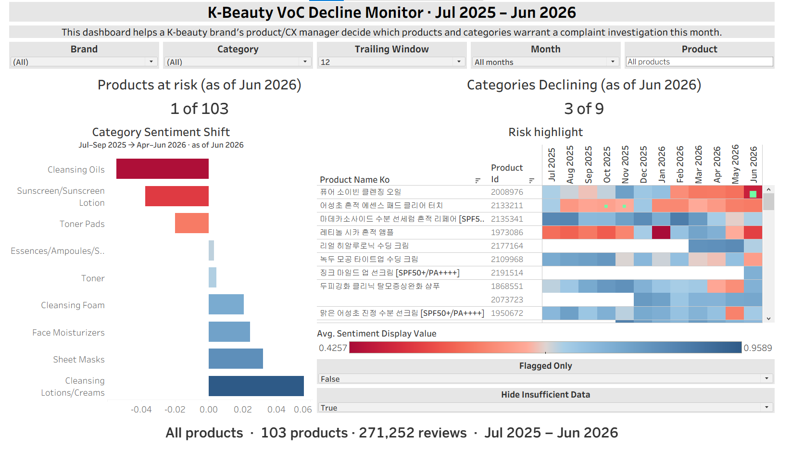
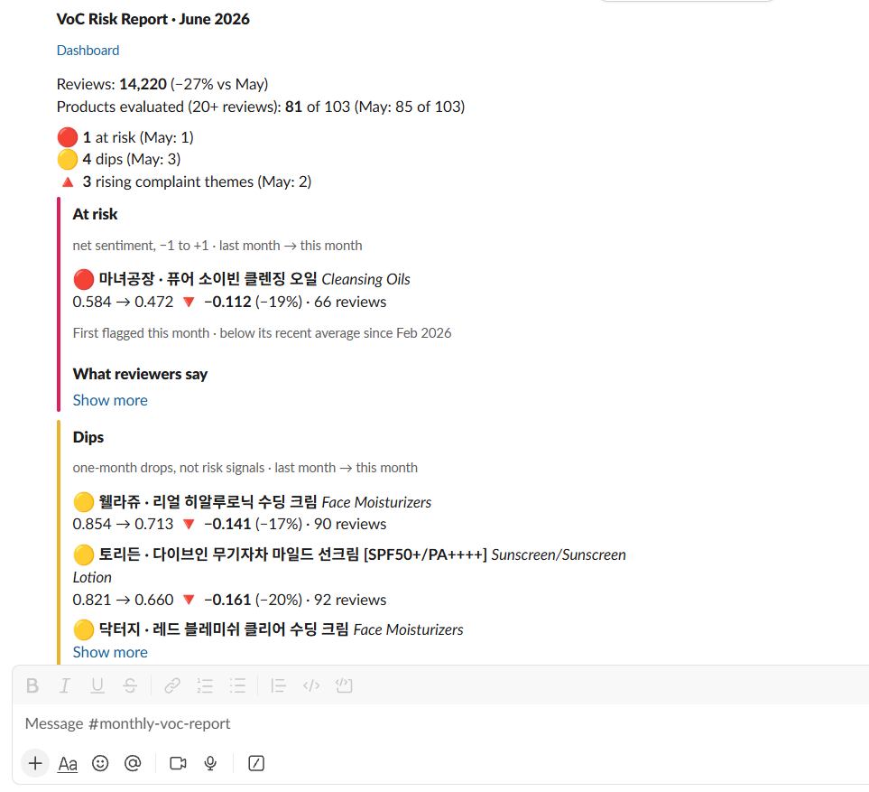
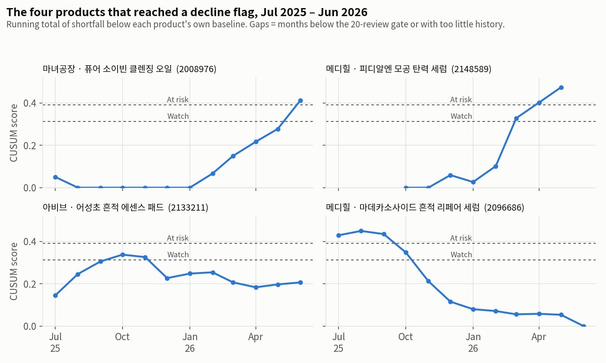
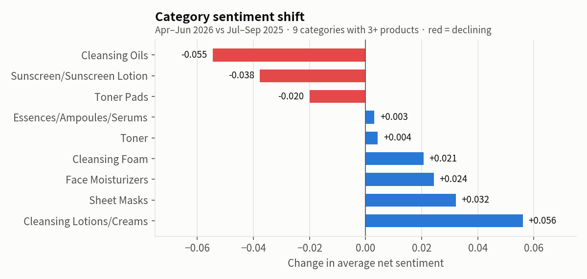

# K-Beauty Voice of Customer Project

## Background & Overview

K-beauty is one of Korea's fastest-growing exports. In 2025, Korean cosmetics exports reached a record **$11.4 billion (+11.8% year over year)**, making Korea the world's second-largest cosmetics exporter after France.[^1] In August 2026, cosmetics exports grew **52.1% year over year to $1.31 billion**, the highest August result on record.[^2] In such a competitive environment, brands need to know how customers feel about their products, which star ratings alone are not able to tell. **92% of the reviews in this project's dataset are 4 or 5 stars**, meaning that products may become less preferred by consumers long before their rating reflects that.

This project focuses on transforming review text data into an early-warning signal. It answers the questions a brand team would ask every month:

1. **Which products are losing customer sentiment?**
2. **What are customers complaining about?**

The data was taken from Hwahae (화해), Korea's leading cosmetics review platform, which passed 10 million cumulative user reviews in March 2026.[^3] **814,452 reviews** of **103 products** across 26 categories and 55 brands total were collected, and the following pipeline was built:

**Hwahae reviews → MySQL → KcELECTRA sentiment classification → BERTopic complaint themes → Tableau Public dashboard → Automated monthly report posted to Slack**

The analysis covers a fixed 12-month window, **July 2025 – June 2026**.

Insights and recommendations cover three areas:

- **Product sentiment risk:** which products are declining against their own recent history
- **Category trends:** how sentiment moved across product categories
- **Complaint themes:** what customers complain about, and which complaints are the strongest

**Links**

- Interactive Tableau dashboard: [ProjectDashboard](https://public.tableau.com/views/ProjectDashboard_17905074206370/Primary?:language=en-US)
- Twelve monthly reports: [`reports/`](reports/)
- Data quality checks: [`sql/`](sql/)

[^1]: Ministry of Food and Drug Safety, via [Korea JoongAng Daily](https://www.koreajoongangdaily.com/business/korea-surpasses-us-in-cosmetics-exports-with-record-114-billion/12713991), May 2026.

[^2]: [Ministry of Trade, Industry and Resources](https://english.motir.go.kr/eng/article/EATCLdfa319ada/2719/view), August 2026 export figures, September 2026.

[^3]: [Byline Network](https://byline.network/2026/03/09_hwahae/), March 2026.

## Data Structure Overview

The dataset covers **814,452 Hwahae reviews** of 103 products, in the period between May 2014 and early July 2026. All insights below use the 12-month window, July 2025 – June 2026.

### Database

The database is stored in MySQL and has two layers:

- **Core (normalized) layer:** the two tables the analysis uses: products and reviews.
- **Analytics mart layer:** the 4 tables and 1 view below, which feed the dashboard and the monthly reports.

| Object | One row per | What it holds |
|---|---|---|
| `review_sentiment_scores_v1` | review | Model scores for the whole review and for each segment (pros, cons, usage tip) |
| `product_monthly_sentiment_v1` *(view)* | product × month | Average net sentiment, review count, 20-review confidence gate |
| `voc_decline_risk_v1` | product × month | CUSUM score and the two decline flags |
| `complaint_topics_v1` | topic | Topic label, theme group, excluded or not |
| `product_complaint_theme_mentions_v1` | topic × product × month | Complaint mention counts and severity |

*The diagram shows only the tables the analysis uses, with key and signature columns. Full table definitions are in [`sql/`](sql/).*

<b>Column reference: what the fields in the diagram mean</b>

| Column | Table | Meaning |
|---|---|---|
| `cons_net_sentiment` | review scores | Sentiment of the review's "cons" part, from −1 to +1: `P(benefit) − 0.5 × P(minor complaint) − P(strong complaint)` |
| `cons_is_complaint` | review scores | TRUE when `cons_net_sentiment` < 0, meaning the cons part is a real complaint. Around 25% of cons are not real complaints but usage tips or even praise. |
| `meets_review_count_gate` | monthly sentiment | TRUE when the product has 20+ reviews that month. Months that have fewer are not used to detect declines. |
| `complaint_count` | monthly sentiment | Number of reviews that month that have real complaints |
| `baseline_net_sentiment` | decline risk | The product's own average net sentiment over its previous 6 months with 20+ reviews (its "normal" level) |
| `cusum_score` | decline risk | Running total of how far the product has fallen below its baseline. 0 means no accumulated decline |
| `voc_decline_flag` | decline risk | **At risk**: `cusum_score` > 5σ (≈ 0.39) |
| `voc_decline_broad_flag` | decline risk | **Watch**: `cusum_score` > 4σ (≈ 0.31) |
| `notable_month_dip` | decline risk | Informational only. A single-month drop of at least 2 standard errors. Not a real risk signal |
| `theme_group` | complaint topics | Which of the 13 complaint themes the topic belongs to |
| `is_excluded` | complaint topics | TRUE for the 7 topics dropped because they weren't real complaints |
| `mention_count` | theme mentions | Distinct reviews mentioning the topic for that product that month |
| `avg_segment_sentiment` | theme mentions | Average `cons_net_sentiment` of those mentions, from about −0.5 (minor) to −1.0 (strong) |
| `strong_complaint_share` | theme mentions | `avg_segment_sentiment` rescaled to 0–1: demonstrates the seriousness of a complaint (the higher, the stronger) |

### Key metrics

| Metric | What it means | How it's calculated |
|---|---|---|
| **Net sentiment** | How positive a review is, from −1 to +1 | `P(positive) − P(negative)`, averaged per product per month. Only months with 20+ reviews count |
| **Segment net sentiment** | How positive a review segment (pros, cons, or usage tip) is, from −1 to +1 | `P(benefit) − 0.5 × P(minor complaint) − P(strong complaint)` |
| **VoC Decline Risk** (CUSUM score) | A running total of how far a product has fallen below its own recent average | `S_t = max(0, S_(t−1) + baseline_t − net_sentiment_t − k)`. The baseline is the product's trailing 6-month average; k = σ/2 ≈ 0.039 |
| **Decline flags** | **Watch** when CUSUM > 0.31; **At risk** when CUSUM > 0.39 | Watch: over 4σ; At risk: over 5σ, where σ = 0.078. Needs 4+ months of history |
| **Strong-complaint share** | Demonstrates the seriousness of a complaint (the higher, the stronger) | Computed in the mart (inside MySQL) from each theme's average segment sentiment |

**Why a CUSUM score?** At first, a simple three-months-in-a-row decline flag was tested, which flagged nothing across the whole 12-year corpus. Although 84 of 103 products had at least one declining month, declines almost never happened consecutively: after a declining month, the next month declined only **6.4%** of the time, against **14.3%** after a normal month. A CUSUM score remembers the recent drops, so one small bounce-back month doesn't reset a multi-month declining trend.

### Sentiment model

Reviews were classified with **KcELECTRA** (`beomi/KcELECTRA-base-v2022`), a Korean language model pre-trained on online comments. The model was fine-tuned for the following classification tasks:

- **Whole review:** 3 classes (high satisfaction, neutral/mixed, frustrated)
- **Review segments** (pros, cons, usage tip): 4 classes (benefit, minor complaint, strong complaint, usage tip)

To measure true accuracy, two evaluation samples were manually labelled and checked against the model's predictions: **1,000 reviews** and **1,189 segments**. Both oversample negative reviews: 85.6% of reviews are positive, so a random sample would have too few complaints to test on.

| Task | Retrained version | First version | Used in the pipeline |
|---|---|---|---|
| Whole review | **0.781** macro-F1 | 0.749 | Retrained |
| Review segments | 0.815 | **0.830** | First version (retraining made it worse) |

A blind check of 20 labels by a native Korean speaker gave Cohen's κ = **0.593**: moderate agreement. Some reviews are hard to label even for people.

### Complaint themes

Complaint themes were created using **BERTopic**, which clusters similar sentences and paragraphs into interpretable groups without supervision (embeddings: `jhgan/ko-sroberta-multitask`; Korean tokenizer: Kiwi). The input was **179,263 complaint texts** from the 12-month window, and one text can belong to more than one topic.

BERTopic found **68 topics**. Every topic was read and labeled manually, and 7 were dropped because they were not real complaints (e.g. "no skin trouble, all good" or filler text). The remaining **61 topics were grouped into 13 theme groups**, for example *Insufficient moisturization* and *Adverse skin reaction*.

### Monthly Slack report

The dashboard shows *which* products are declining. The monthly report, posted to Slack, shows what customers are saying about those products, so a manager can see where to look without opening the dashboard or reading through the reviews.

For each product flagged *watch* or *at risk* that month, an LLM (`gpt-5.6-sol`) reads **all** of the product's complaints for the month, including the ones BERTopic left uncategorized. For the June 2026 at-risk product, those were 22 of its 45 complaint texts (49%), which the theme charts can't show at all. The LLM:

- **groups the complaints into the product's own labels**, more specific than the 13 themes (e.g. "oily heavy feel" rather than *Too heavy / oily-skin mismatch*).
- **picks review quotes** for the top labels, along with up to four "worth a look" reviews that mention a new and specific point (for example, for 2008976: the eye area stays cloudy after the first cleanse).

To avoid inaccurate numbers, all numbers in the report come from the database rather than the LLM, and automated checks reject a report if a quote isn't word-for-word from a real review or if it uses causal or trend language. The model only describes complaints and is deliberately restricted from stating causes or giving recommendations.

The report gives a manager the month at a glance: review volume against last month, how many products had enough reviews to evaluate, the number of at-risk products and one-month dips, each flagged product's sentiment change, and a link to the dashboard.

### Code and checks

- Text preprocessing (SQL): [`sql/mysql_preprocessing.sql`](sql/). It keeps emoticons (ㅋㅋ, ㅠㅠ), stretched words (좋아아아) and informal punctuation (;;, ...) because they carry sentiment, and only cleans whitespace and invisible characters.
- Data quality checks: [`sql/`](sql/)
- Model training and evaluation: [`sentiment/`](sentiment/)
- Topic extraction and labels: [`topics/`](topics/)
- Report generation and checks: [`report/`](report/)

## Executive Summary

Across 271,252 reviews in the 12-month window, the monitor found **one product at risk as of June 2026**, three declining categories, and one complaint theme with especially severe complaints. Reviews stay overwhelmingly positive (86.8%), so every decline below is a modest drop rather than a wave of negative reviews.

- **One product is at risk as of June 2026: 마녀공장 (manyo) 퓨어 소이빈 클렌징 오일.** Its net sentiment fell from 0.746 in January to 0.472 in June, and it has been below its own recent average every month since February. Over January–June it averaged 0.603, against 0.744 for its category. In June, its most common complaints were an oily or heavy feel (10 of 45) and adverse skin reactions (7 of 45).
- **Four products were flagged in the 12-month window, three of which reached the "at risk" flag.** One of those products, 메디힐 (MEDIHEAL) 마데카소사이드 흔적 리페어 세럼, was flagged in July–September 2025, but the flag reflected a decline from before the window. The product was already recovering.
- **3 of 9 eligible categories (having 3+ products) declined:** Cleansing Oils (−0.055), Sunscreen (−0.038) and Toner Pads (−0.020), comparing April–June 2026 with July–September 2025.
- **Complaints follow the seasons.** Moisturization complaints rose from 14–15% of all complaints in summer to 21% in January, while oily-feel complaints did the opposite. One year can't prove it, but this pattern fits Korea's dry winters and humid summers.
- **Adverse skin reaction is the most severe complaint.** Almost a third (32.8%) of its mentions read as strong complaints, against 6.0% for the next-highest theme (No visible improvement).

*June 2026 Slack channel report, cropped. Full text: [`reports/report_2026-06.md`](reports/report_2026-06.md)*

## Insights Deep Dive

### 1. Product sentiment risk

Four products reached a decline flag during the window. Only one is a confirmed problem ("At risk") as of June 2026.

#### At risk now (June 2026): 마녀공장 (manyo) 퓨어 소이빈 클렌징 오일 · Cleansing Oils (2008976)

Net sentiment stayed between 0.68 and 0.81 through January 2026 (0.746 that month). It then fell to 0.624 in February and kept declining, reaching **0.472 in June**: a drop of 0.274 (−37%) in five months. It has been below its own 6-month baseline sentiment (what the CUSUM score measures against) every month since February, and the running score crossed the at-risk line in June.

Over January–June 2026, it averaged **0.603**, against **0.744** for Cleansing Oils (−0.141).

In June 2026, of 45 complaint texts, the top labels were oily or heavy feel (10), skin reactions (7) and poor pore cleansing (6).

#### At risk in April–May 2026: 메디힐 (MEDIHEAL) 피디알엔 모공 탄력 세럼 · Essences/Ampoules/Serums (2148589)

Sentiment fell from 0.837 in November 2025 to **0.519 in March 2026**. The score reached *watch* in March and *at risk* in April and May. In June the product had only **19 reviews**, below the 20-review threshold, so the monitor couldn't evaluate it that month. Its reviews had been falling for months, from 591 in October. The two "At risk" months are based on just 29 and 26 reviews, respectively.

#### Watch in October–November 2025: 아비브 (Abib) 어성초 흔적 에센스 패드 클리어 터치 · Toner Pads (2133211)

Its decline started in June 2025 (right before the window). The score reached *watch* in October–November 2025 and never reached *at risk*. It has eased but not cleared: the CUSUM score was still 0.206 in June 2026, with sentiment at 0.597, against 0.719 a year earlier.

#### Flagged, but not a new decline: 메디힐 (MEDIHEAL) 마데카소사이드 흔적 리페어 세럼 · Essences/Ampoules/Serums (2096686)

It was at risk in July–September 2025, but its decline began in **January 2025**, six months before the window. Inside the window it was recovering: from 0.513 in July to 0.639 in November, with the CUSUM score back to 0 by June 2026. The flag was right about the past, but in July 2025 the product was already steadily recovering from that problem. This case clearly demonstrates the key principle of CUSUM, which has a memory of previous declines and does not declare recovery after a single rise.

### 2. Category trends

Comparing April–June 2026 with July–September 2025, **3 of the 9 categories** with at least 3 products declined. The other six improved, Cleansing Lotions/Creams most (+0.056). All three declines are small against a high base: Cleansing Oils moved from 0.780 to 0.725 (−7%).

- **Cleansing Oils (−0.055)** has multiple products with falling sentiment, so the drop can't be attributed only to the above-mentioned 2008976: 2008976 fell −0.149, and 프리메이 리얼 딥 클렌징오일 (2119993) also fell −0.077.
- **Sunscreen (−0.038)** has three out of six products declining by 0.08–0.12 (2135341, 2131678, 1950672), with none of them flagged.
- **Toner Pads (−0.020)** decline is mostly caused by the watch-tier pad above (−0.058) and 1890624 (−0.034).

### 3. Complaint themes

Over the 12 months, 122,171 complaint mentions fell into the 13 themes. The largest themes are:

| Theme | Share of mentions | Strong-complaint share |
|---|---|---|
| Insufficient moisturization | 18.1% | 1.6% |
| Texture & finish | 14.3% | 3.4% |
| No visible improvement | 10.4% | 6.0% |
| Packaging & dispensing | 8.6% | 1.1% |
| Adverse skin reaction | 8.1% | **32.8%** |

While *Insufficient moisturization* is the most frequently mentioned complaint theme (22,165 mentions in total), *Adverse skin reaction* is where customers complain by far the most severely: a third of its mentions are strong complaints, more than five times the share of any other theme.

Some themes can't be considered simply good or bad: *Scent* is a split complaint that contains both "scent is too strong" and "scent is too faint" kinds of complaints. A scent complaint alone doesn't say which way the product should change.

Among the 78 products with complaints in every month of the window, *Insufficient moisturization* made up 14–15% of complaint mentions in summer 2025, climbed to 21% in January, and then dropped back to 18% by June. *Too heavy / oily-skin mismatch* moved the opposite way: it was lowest in December (3.8%) and higher in both summers (6.1% in July 2025, 6.4% in June 2026). One year of data can't prove this is seasonal, but **dry Korean winters and humid summers would produce exactly this pattern, so it's the most likely explanation**.

Comparing the two halves of the year directly is left out: products launched mid-window and small counts made those shifts unreliable (the Slack reports still show them).

## Recommendations

This data shows *where* customers are unhappy, not *why*, so none of these recommendations says what to change in a product. Each one points a brand team at where to look first.

1. **Further investigate the at-risk cleansing oil now (2008976).**  
   Read its most common June complaints and check them against anything that changed around February 2026, when the decline began.
2. **Check the MEDIHEAL pore serum (2148589) complaints from June 2026.**  
   It fell below the 20-review threshold, so the monitor can't tell if it actually recovered. Review it manually, or evaluate it over a quarterly window, until its volume returns.
3. **Watch the other declines that have not yet been flagged as "Watch" or "At risk".**  
   The cleansing oil (2119993) and the Sunscreen category are both falling without crossing a threshold yet.
4. **Read skin-reaction complaints first.**  
   They're only 8% of complaints, but a third of them are strong, so they're where an unhappy customer is most likely to stop buying.
5. **Plan for the seasons, then confirm them.**  
   Expect moisturization complaints to rise again this winter, and compare January 2027 with January 2026 to check the pattern.

## Limitations and caveats

**The data**

- **One year of data**  
With only 12 months of analyzed data, seasonal patterns can't be confirmed. The seasonal reading in Complaint themes is the most likely explanation, but it isn't proven.
- **Review volume varies widely by month**  
Monthly reviews jumped from 20,236 in September 2025 to 28,360 in October (+40%), stayed between 23,000 and 29,000 through March 2026, then fell to 14,220 in June (−47% from March). The cause is not known, and falling volume pushes more products below the 20+ review gate.
- **24% of product-months are marked insufficient data**  
301 of 1,236 product-months, where a product had no reviews, fewer than 20, or too little history. The monitor can't see those months, as with 2148589 in June 2026.
- **Only 9 of 26 categories are compared**  
Category trends need at least 3 products.

**The model**

- **Mixed (3-star) reviews are a blind spot**  
The model never trained on the "cons" text of 3-star reviews. On 196 such texts it scored a macro-F1 of 0.46, and it labels most of them as minor complaints.
- **About 3.4% of real complaints are missed**  
The model sometimes reads a complaint as a usage tip (19 of 566 in the manually labeled evaluation sample).
- **29% of complaint mentions fit no theme**  
BERTopic left 50,146 of 172,317 mentions uncategorized, so theme shares are shares of the other 71%.

**The monitor and reports**

- **The initial decline rule did not flag any products**  
"Three declining months in a row" failed to flag any product in the whole 12-year period of the dataset. This became the reason for the CUSUM design choice (see [Data Structure Overview](#data-structure-overview)).
- **The twelve monthly reports are replays**  
They were generated in September 2026 by today's monitor, with thresholds calibrated on data through June 2026, and posted to a private test channel. They show what the monitor *would have said* each month, not reports sent at the time.

## Data source and use

The reviews were collected from Hwahae (화해) for non-commercial research. No login or paid access was used. This project is not affiliated with or endorsed by Hwahae Global Inc. or any brand shown.

- No raw reviews, reviewer IDs or reviewer profile fields are published. The data files in this repository hold aggregates and model scores, with review IDs replaced by anonymous keys.
- The monthly reports quote a few short reviews word for word, with review IDs removed. The dashboard shows complaint excerpts of up to 150 characters.
- "At risk" and "watch" are statistical signals from a sentiment model and a CUSUM test, not judgments of product quality.

